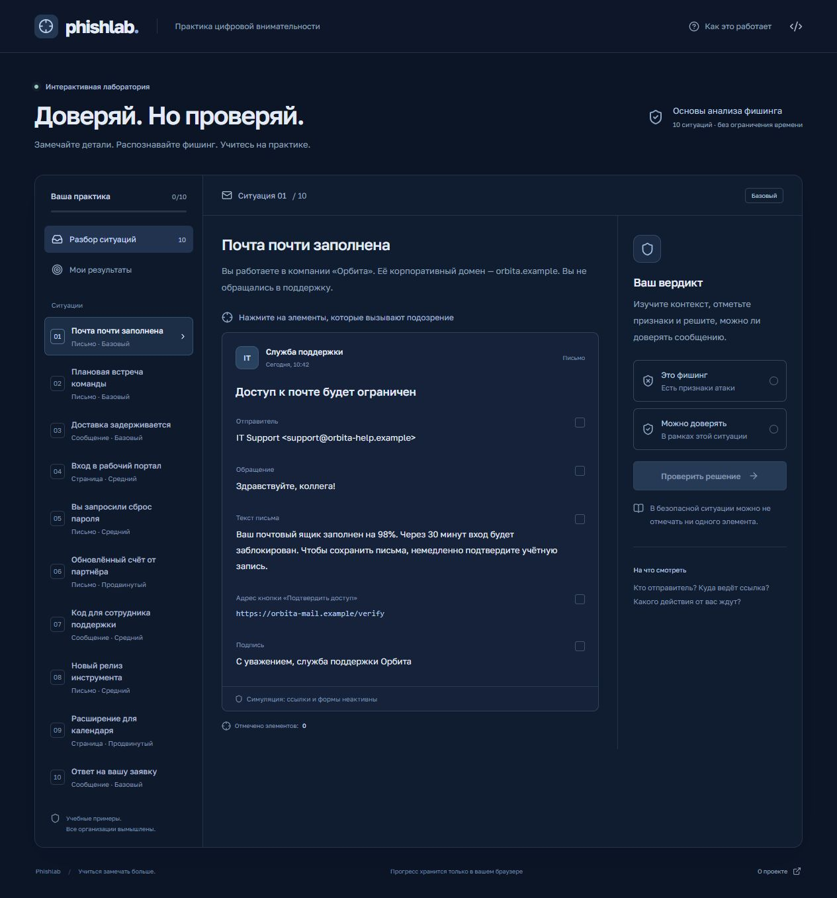

# Phishlab

Интерактивная лаборатория распознавания фишинга для начинающих специалистов по информационной безопасности. Пользователь изучает контекст, отмечает подозрительные элементы и проверяет свой вердикт.

**React · TypeScript · Vite · Vitest**

[Открыть тренажёр](https://rompel2000.github.io/phishlab/)



## Возможности

- 10 вымышленных ситуаций: письма, сообщения и страницы входа или согласия.
- Выбор подозрительных элементов непосредственно в учебном примере.
- Отдельная оценка вердикта и найденных признаков; учёт пропусков и лишних отметок.
- Объяснения и рекомендуемое действие после каждого ответа.
- Результаты, повтор ошибочных разборов и сброс с подтверждением.
- Восстановление прогресса через localStorage, обработка повреждённых данных и недоступного хранилища.
- Адаптивная компоновка, клавиатурное управление, видимый фокус и поддержка reduced motion.

## Локальный запуск

Требуется Node.js 24 LTS с npm.

```bash
git clone https://github.com/ROMPEL2000/phishlab.git
cd phishlab
npm ci
npm run dev
```

```bash
npm test        # Проверки оценивания и восстановления прогресса
npm run build  # Проверка TypeScript и сборка в docs/
npm run preview
```

Сервер разработки слушает только `127.0.0.1`. Для демонстрации используется статическая production-сборка.

## Как устроено

| Файл                | Назначение                                                              |
| ------------------- | ----------------------------------------------------------------------- |
| `src/data.ts`       | Сценарии, признаки, объяснения и рекомендации                           |
| `src/logic.ts`      | Чистые функции оценки и проверки сохранённых ответов                    |
| `src/logic.test.ts` | Тесты вердиктов, пропущенных признаков, ложных отметок и восстановления |
| `src/main.tsx`      | Интерфейс тренажёра и управление состоянием                             |
| `src/style.css`     | Адаптивная тема, состояния выбора и доступность                         |
| `docs/`             | Готовая статическая сборка для GitHub Pages                             |

Новая ситуация добавляется в массив `scenarios`: контекст, элементы для анализа, вердикт и пояснения. Полностью верным считается разбор с правильным вердиктом, всеми нужными признаками и без лишних отметок. Повтор заменяет предыдущий ответ; результат показывает текущую практику, а не первую попытку.

## Публикация

GitHub Pages настроен на ветку `main`, папку `/docs`. После изменений выполните `npm run build` и включите обновлённую папку `docs` в коммит. Относительные пути позволяют работать под адресом репозитория. Сервер и база данных не нужны.

## Границы учебной модели

Примеры не являются анализом реальных писем. Вердикт определяется заданным контекстом; знакомый отправитель или HTTPS сами по себе не подтверждают безопасность. В реальной работе необходимы независимая проверка и процедуры организации.

Все организации вымышлены, учебные адреса используют `.example`, ссылки внутри симуляций неактивны. Приложение не собирает пароли, не отправляет ответы на сервер и не использует аналитику. Шрифт Golos Text поставляется локально через Fontsource, лицензия — SIL Open Font License 1.1 (см. `THIRD_PARTY_NOTICES.md`).

Справочный материал: [CISA — Recognize and Report Phishing](https://www.cisa.gov/secure-our-world/recognize-and-report-phishing).

## Проверка

Автоматизированные тесты покрывают оценивание всех десяти сценариев и восстановление сохранённых ответов. В браузере проверены верный и неверный ответы, безопасный сценарий, повтор ошибок, сохранение после перезагрузки и мобильная компоновка.

Перед обновлением инструментов разработки проверяйте `npm audit`. Известные предупреждения в dev-зависимостях не означают наличие этих инструментов в статическом сайте; не открывайте dev-сервер в публичную сеть.
